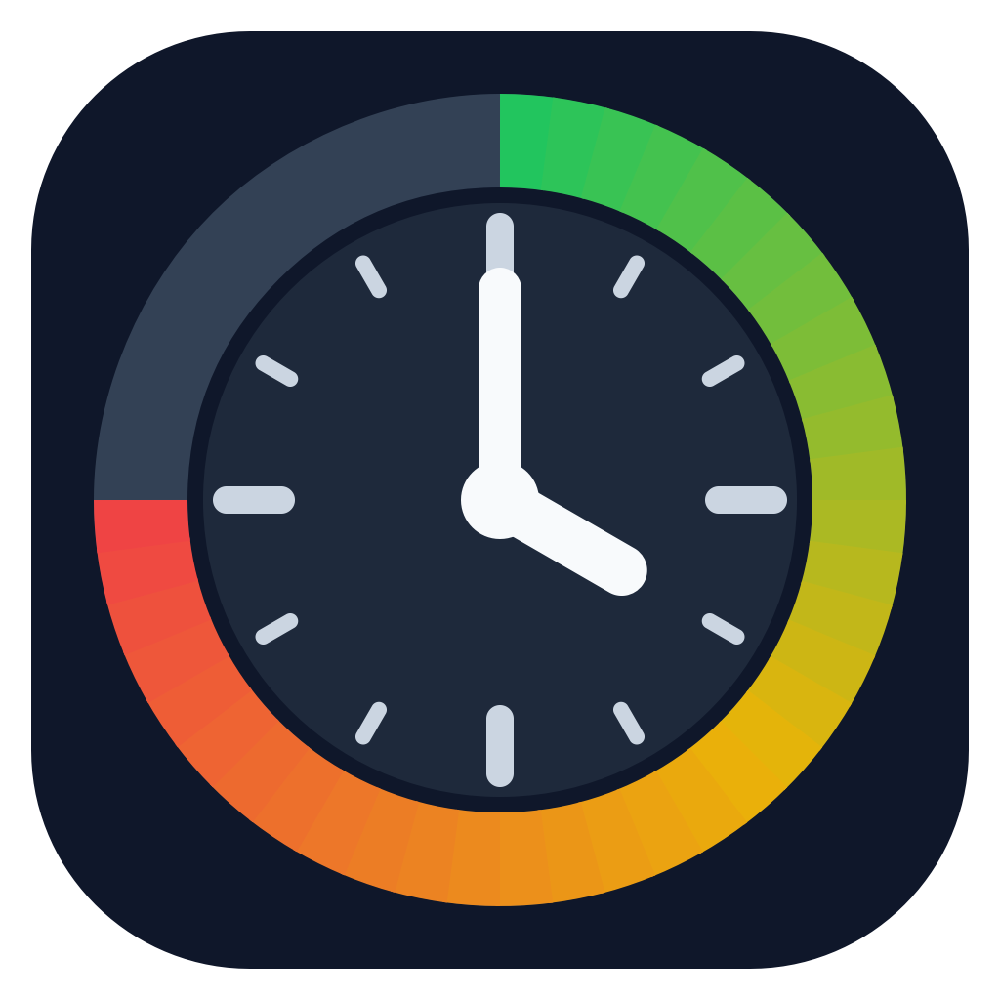
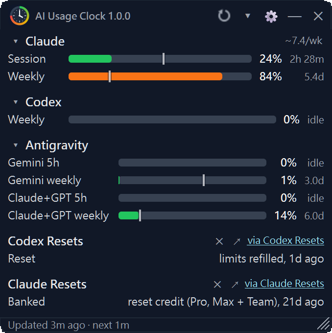
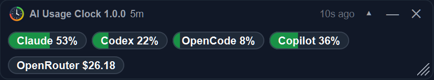

<p align="center">
  
</p>

<h1 align="center">AI Usage Clock</h1>

<p align="center"><strong>Vidu ĉiun AI-limon. Sciu ĉiun restarigon.</strong></p>

<p align="center">
  Unu eta labortabla ilo por la uzlimoj de viaj AI-servoj. Ĝi ankaŭ kaptas<br />
  la restarigajn anoncojn de Codex kaj Claude: antaŭavizon, kiam restarigo estas anoncita antaŭtempe,<br />
  kaj lokon por kontroli, kiam via uzo subite falas al nulo.
</p>

<p align="center">
  <a href="README.md">English</a> · <a href="README.zh-Hant.md">繁體中文</a> · <a href="README.zh-Hans.md">简体中文</a> · <a href="README.ja.md">日本語</a> · <a href="README.es.md">Español</a> · <a href="README.fr.md">Français</a> · <a href="README.de.md">Deutsch</a> · <a href="README.pt-BR.md">Português (Brasil)</a> · <a href="README.vi.md">Tiếng Việt</a> · <strong>Esperanto</strong>
</p>

<p align="center">
  <a href="https://github.com/AIUsageClock/ai-usage-clock/actions/workflows/test.yml"></a>
  
  
</p>

<p align="center">
  <a href="https://github.com/AIUsageClock/ai-usage-clock/releases/latest"></a>
  <a href="https://aiusageclock.com/eo/"></a>
</p>

<p align="center">
  
</p>

<p align="center"><sub>La ilo en Windows, kaptita de funkcianta eldono. La uzaj valoroj respondas al la momento de la kapto.</sub></p>

<p align="center">
  
</p>

<p align="center"><sub>La kompakta reĝimo malgrandigas la ilon al unu kapsulo por ĉiu servo (ekzemplaj datumoj).</sub></p>

## Kial AI Usage Clock

- **Viaj AI-limoj en unu loko.** Claude, Codex, Antigravity, OpenCode Go, GitHub Copilot, OpenRouter kaj Linear, flanko apud flanko, ĉiu kun sia propra uzostrio. Ĉe aktivaj limoj la restanta tempo aperas ankaŭ apud la strio.
- **Antaŭavizo pri iuj restarigoj, loko por kontroli post la subitaj.** Ŝaltu la restarigajn anoncojn, kaj AI Usage Clock kaptos la restarigajn anoncojn de Codex kaj Claude. Iuj restarigoj estas anoncitaj antaŭtempe (la anoncoj de Codex, plus vico **Watch** kun AI-prognozo), do vi povas prepari vin. Aliaj okazas subite: la karto tenas la plej freŝan anoncon videbla, do kiam via uzo subite falas al nulo, vi povas kontroli, ĉu restarigo ĵus okazis, kun unu klako al la originala afiŝo.
- **Sciigo, kiam aperas nova anonco.** Laŭvole vi povas ricevi sciigon, kiam aperas nova anonco (sistemaj sciigoj en Windows), kun aparta ŝaltilo por ĉiu tipo. La anoncoj venas de sendependaj triaj spurantoj kaj povas malfruiĝi aŭ erari, do kontrolu la originalan afiŝon. Ĉi tiu funkcio estas norme malŝaltita.
- **Ĝi funkcias en via komputilo.** Ne ekzistas konto de AI Usage Clock, nek servilo, nek telemetrio. API-ŝlosiloj estas konservataj en la sekura stokejo de via operaciumo. Ankaŭ la ensalutaj seancoj de Claude kaj ChatGPT estas konservataj tie, kaj krome en la dosierujo de la propra retumila profilo de la programo.

## Komencu per 3 paŝoj

1. **Elŝutu** la arkivon por via sistemo el la [plej nova eldono](https://github.com/AIUsageClock/ai-usage-clock/releases/latest): `ai-usage-clock-<version>-windows.zip`, `ai-usage-clock-<version>-macos.tar.gz` aŭ `ai-usage-clock-<version>-linux.tar.gz`.
2. **Malpaku ĝin kaj lanĉu ĝin.**
   - Windows: rulu `ai-usage-clock.exe`
   - macOS: trenu `ai-usage-clock.app` al Applications (Programoj), poste malfermu ĝin
   - Linux: rulu `./ai-usage-clock/ai-usage-clock`
3. **Konektu viajn servojn.** Ensalutu en Claude kaj Codex en la programo, aŭ algluu API-ŝlosilon en **Settings**. Vidu la [agordan gvidilon](docs/setup.md) (en la angla).

La eldonaj versioj ne estas ciferece subskribitaj, do Windows aŭ macOS povas averti ĉe la unua lanĉo. [Jen kion fari](#smartscreen-aŭ-gatekeeper-avertas-ĉe-la-unua-lanĉo).

## Subtenataj servoj

| Servo | Kion vi vidas | Kiel ĝi konektiĝas |
| --- | --- | --- |
| **Claude** | Limoj Session kaj Weekly (plus la semajna limo de Fable ĉe planoj, kiuj havas tian) | Ensalutu per via retumilo (Google kaj pasŝlosiloj funkcias), aŭ algluu seancan kuketon |
| **Codex** (ChatGPT) | Limoj Session kaj Weekly | Same kiel Claude |
| **Antigravity** | Uzo de Gemini kaj de Claude+GPT, ĉiu kun 5-hora kaj semajna limo | Ĝi legas vian lokan komandlinian ilon `agy`; neniu konto aŭ ŝlosilo en la programo |
| **OpenCode Go** | Uzo Rolling, Weekly kaj Monthly | API-ŝlosilo de OpenCode |
| **GitHub Copilot** | Monataj AI-kreditoj, uzitaj kontraŭ la inkluzivita kvanto de via plano, restarigataj je la 1-a | Fine-grained personal access token de GitHub |
| **OpenRouter** | Elspezo hodiaŭ kaj ĉi tiu monato, laŭvola taga buĝeto; saldo kaj modela agado per administra ŝlosilo | API-ŝlosilo de OpenRouter |
| **Linear** | Nombro de issues kontraŭ la limo de 250 issues de la senpaga plano (pagaj planoj montras "no limit") | Persona API-ŝlosilo de Linear |

Claude, Codex kaj GitHub Copilot estas norme ŝaltitaj. La aliaj servoj, kaj la restarigaj anoncoj, estas ŝaltataj en **Settings**. Vi povas sekvi pli ol unu konton de Claude, Codex aŭ OpenCode Go.

## Por AI-agentoj (MCP)

AI Usage Clock inkluzivas laŭvolan lokan MCP-servilon, norme malŝaltitan. Ĝi permesas al programadaj agentoj kontroli vian uzon antaŭ ol komenci multekostan laboron, kaj paŭzi, kiam atingiĝas limo, kiun vi starigis. Ĝi legas nur purigitan lokan kaŝmemoron de uzo, neniam viajn ensalutajn datumojn. La agordo estas en [docs/mcp.md](docs/mcp.md) (en la angla).

## Oftaj demandoj

### Kiel funkcias la restarigaj anoncoj?

Ili estas norme malŝaltitaj. Ŝaltu ilin en **Settings → General** per **Codex Resets** aŭ **Claude Resets**. Tiam AI Usage Clock legas du sendependajn triajn spurantojn: codex-resets.com (kiu uzas AI por klasifiki afiŝojn de @thsottiaux) kaj claude-resets.com (kiu kolektas afiŝojn de @ClaudeDevs kaj de membroj de la teamo de Claude Code). Dum la programo funkcias, ĝi demandas ĉiun spurantan retejon maksimume unufoje ĉiujn 15 minutojn (relanĉo de la programo demandas denove).

La karto montras la plej freŝan eventon kaj kiom longe antaŭe ĝi okazis, markitan laŭ tipo:

- **Announced** (anoncita): restarigo estis anoncita antaŭtempe. Nur Codex havas ĉi tiun tipon.
- **Reset** (restarigo): la limoj estis replenigitaj.
- **Banked** (restarigkupono): oni donis al vi restarigkuponon, kiun vi mem povas eluzi.

La karto de Codex havas ankaŭ vicon **Watch**: AI-prognozon pri tio, kiom verŝajna estas restarigo. Ĝi ne estas oficiala anonco, kaj ĝi neniam sendas sciigon. Alklaku ↗ por malfermi la originalan afiŝon, aŭ ✕ por kaŝi la karton ĝis alvenos la sekva enskribo.

En **Settings → Reset alerts** vi elektas, pri kiuj tipoj vi ricevu sciigon (Codex: announced, reset, banked; Claude: reset, banked). La unua evento, kiun la programo iam trovas ĉe spuranto, estas nur registrita, ne sciigita. Windows uzas sistemajn sciigojn, kiuj malfermas la originalan afiŝon per klako; aliaj sistemoj uzas balonon en la sistempleto (system tray), se pleto ekzistas. En la menubara reĝimo de macOS kaj en Linux sen pleto ne estas sciigoj, kvankam la kartoj ankoraŭ aktualiĝas.

La datumojn kompilas triaj flankoj, kaj ili povas malfruiĝi aŭ erari (novaj enskriboj de Claude povas resti provizoraj dum maksimume 24 horoj), do rigardu la originalan afiŝon kiel la fidindan fonton.

### Ĉu ĝi estas oficiala programo?

Ne. AI Usage Clock estas sendependa malfermitkoda projekto kaj neoficiala loka labortabla ilo, ne farita nek aprobita de iu el la servoj, kiujn ĝi montras. Paĝoj kaj API-oj de la provizantoj povas ŝanĝiĝi sen avizo.

### Kien iras miaj datumoj?

Viaj agordoj, uzhistorio kaj ensalutaj seancoj restas en via komputilo. Seancoj kaj API-ŝlosiloj estas konservataj per la sekura stokado de via operaciumo: Credential Manager kaj DPAPI en Windows, Keychain en macOS, Secret Service en Linux. Seancoj de Claude kaj ChatGPT estas konservataj ankaŭ en la dosierujo de la propra retumila profilo de la programo. Ne ekzistas telemetrio, nek servilo de AI Usage Clock. La programo konektiĝas rekte al la servoj, kiujn vi ŝaltas: la uzpaĝoj de Claude kaj ChatGPT (ŝargitaj en enkonstruita retumilo), kaj la API-oj de GitHub, OpenCode, OpenRouter kaj Linear. Linear (api.linear.app) ricevas nur vian API-ŝlosilon kaj unu peton pri la nombro de issues. La uzo de Antigravity venas de la ilo `agy` en via komputilo, kiun la programo rulas por vi; `agy` mem prizorgas siajn konektojn. Se vi ŝaltas la restarigajn anoncojn, ĝi kontaktas ankaŭ codex-resets.com kaj claude-resets.com; tiuj retejoj vidas vian IP-adreson kaj la nomon kaj version de la programo. La laŭvola loka kostospurado legas la protokolojn de Claude Code kaj Codex en via komputilo kaj nenion alŝutas. Pli en [SECURITY.md](SECURITY.md) (en la angla).

### SmartScreen aŭ Gatekeeper avertas ĉe la unua lanĉo

La eldonaj versioj ne estas ciferece subskribitaj, kaj SHA256-sumoj estas publikigitaj apud ĉiu arkivo.

- **Windows:** se SmartScreen avertas, alklaku **More info** (Pliaj informoj), poste **Run anyway** (Tamen ruli).
- **macOS:** Gatekeeper blokas la programon la unuan fojon. Provu malfermi ĝin unufoje, poste iru al **System Settings → Privacy & Security** (Sistemaj agordoj → Privateco kaj sekureco), trovu la programon en la sekcio Security (Sekureco), alklaku **Open**, poste **Open Anyway** (Tamen malfermi), enigu vian ensalutan pasvorton kaj alklaku **OK** (la butono **Open Anyway** disponeblas dum ĉirkaŭ unu horo post la provo). Aŭ unufoje rulu `xattr -dr com.apple.quarantine ai-usage-clock.app`.
- **Linux:** ne ekzistas subskriba tavolo. Faru `ai-usage-clock` rulebla, se ĝi ankoraŭ ne estas.

Pli da detaloj, inkluzive de la MCP-helpilo en macOS, estas en [docs/build.md](docs/build.md#first-launch-warnings-on-unsigned-builds) (en la angla).

### Ĉu mi bezonas Python?

Ne por la elŝutoj: Python kaj la retumila motoro estas inkluzivitaj. Python 3.11 aŭ pli nova necesas nur por ruli la programon el la fontkodo aŭ por kontribui; vidu [docs/build.md](docs/build.md) (en la angla).

### Ĉu ĝi funkcias en macOS kaj Linux?

Jes, kun averto. Windows estas la platformo, en kiu ĝi estas disvolvata kaj testata per realaj kontoj. La versioj por macOS (menubara ero anstataŭ flosanta ilo) kaj Linux estas publikigitaj, kaj la aŭtomataj testoj funkcias en ĉiuj tri sistemoj, sed la aktualigo de realaj kontoj estas konfirmita nur en Windows 11, do rigardu macOS kaj Linux kiel fruajn. Sciigoj pri restarigoj diferencas laŭ sistemo; vidu la unuan demandon. Bonvolu [malfermi issue](https://github.com/AIUsageClock/ai-usage-clock/issues), se io ne ĝustas.

### Ĉu ĝi estas senpaga?

Jes. Ĝi estas senpaga kaj malfermitkoda laŭ la MIT-licenco. La servoj, kiujn ĝi montras, bezonas siajn proprajn kontojn aŭ abonojn.

<a id="donate"></a>

## Donaci

AI Usage Clock estas senpage uzebla, ĉu vi donacas, ĉu ne. Se ĝi ŝparis al vi iom da tempo kaj vi volas danki, vi povas sendi ĉifromonon al la suba adreso. Ajna ĵetono en Ethereum aŭ Polygon estas bonvena: ETH, POL, USDT, USDC aŭ io ajn alia. Ĝi estas la sama adreso en ambaŭ retoj.

```
0x6c60bFCaDfb3AD63eC6D821baB0E6323361BFD4f
```

<p align="center"></p>

- Nur transigoj en Ethereum (ERC20) kaj Polygon estas akceptataj. Se vi povas uzi ambaŭ, Polygon kutime havas pli malaltajn kostojn.
- Ĉi tiu estas la sola oficiala adreso, kaj la sama estas montrata ĉe [aiusageclock.com](https://aiusageclock.com/eo/#donate). Neniam oni petos vin sendi al alia adreso.
- Transigoj en la blokĉeno ne povas esti malfaritaj, do ili ne povas esti repagitaj.

Stelumi AI Usage Clock en GitHub aŭ paroli pri ĝi al amiko ankaŭ helpas.

## Pli

[Agorda gvidilo](docs/setup.md) (en la angla) · [Ĉiutaga uzo](docs/usage.md) (en la angla) · [MCP-uzgardilo](docs/mcp.md) (en la angla) · [Konstrui el fontkodo](docs/build.md) (en la angla) · [Kontribui](CONTRIBUTING.md) (en la angla) · [Sekureco](SECURITY.md) (en la angla) · [Licenco (MIT)](LICENSE) (en la angla)

Nuna versio: **1.1.0** · [Ŝanĝoprotokolo](CHANGELOG.md) (en la angla)

AI Usage Clock ne estas ligita kun Anthropic, OpenAI, Google, GitHub, Microsoft, OpenCode, OpenRouter, Linear, nek kun iu alia provizanto. Produktaj nomoj apartenas al siaj posedantoj.
