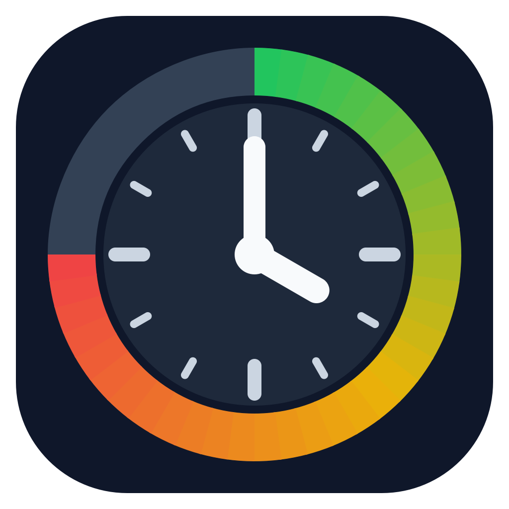
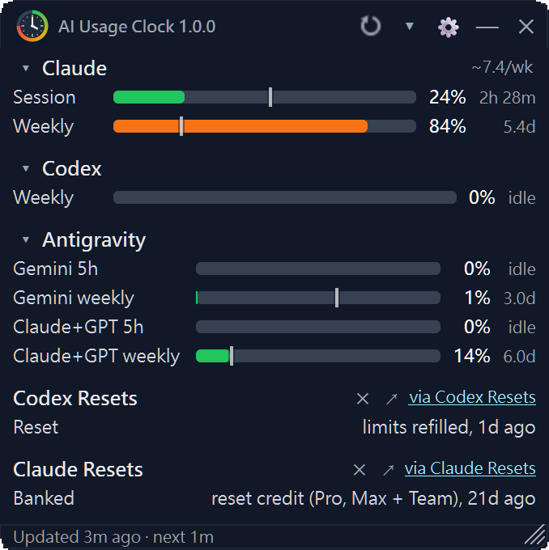
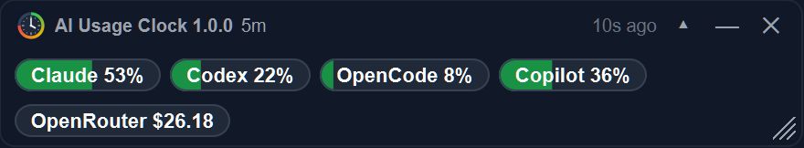

  

<h1 align="center">AI Usage Clock</h1>

<strong>See every AI limit. Know every reset.</strong>

  One small desktop widget for the usage limits of your AI services. It also picks up 
  Codex and Claude reset announcements: a heads-up when a reset is announced ahead of time, 
  and a place to look when your usage suddenly drops to zero.

  <strong>English</strong> · <a href="README.zh-TW.md">繁體中文</a> · <a href="README.zh-CN.md">简体中文</a> · <a href="README.ja.md">日本語</a> · <a href="README.es.md">Español</a> · <a href="README.fr.md">Français</a> · <a href="README.de.md">Deutsch</a>

  
  
  

  
  

  

The Windows widget, captured from a running release. Usage values reflect the time of capture.

  

Compact mode shrinks the widget to one pill per service (sample data).

## Why AI Usage Clock

- **Your AI limits in one place.** Claude, Codex, Antigravity, OpenCode Go, GitHub Copilot, OpenRouter, and Linear, side by side, each with its own usage bar. Active limits also show the time left next to the bar.
- **A heads-up before some resets, a place to check after the sudden ones.** Turn on reset announcements and AI Usage Clock picks up Codex and Claude reset announcements. Some resets are announced ahead of time (Codex announcements, plus an AI-predicted Watch row), so you can get ready. Others come out of nowhere: the tile keeps the latest announcement in view, so when your usage suddenly drops to zero you can check whether a reset just happened, with one click to the original post.
- **Get notified when one appears.** Optionally get a notification when a new announcement shows up (native notifications on Windows), with a separate switch for each type. The announcements come from independent third-party trackers and can be late or wrong, so check the original post. This feature is off by default.
- **It runs on your computer.** There is no AI Usage Clock account, server, or telemetry. API keys are kept in your operating system's secure storage. Claude and ChatGPT sign-in sessions are kept there too, plus in the app's own browser profile folder.

## Get started in 3 steps

1. **Download** the archive for your system from the [latest release](https://github.com/AIUsageClock/ai-usage-clock/releases/latest): `ai-usage-clock-<version>-windows.zip`, `ai-usage-clock-<version>-macos.tar.gz`, or `ai-usage-clock-<version>-linux.tar.gz`.
2. **Extract it and run it.**
   - Windows: run `ai-usage-clock.exe`
   - macOS: drag `ai-usage-clock.app` to Applications, then open it
   - Linux: run `./ai-usage-clock/ai-usage-clock`
3. **Connect your services.** Sign in to Claude and Codex in the app, or paste an API key in **Settings**. See the [setup guide](docs/setup.md).

The builds are unsigned, so Windows or macOS may warn the first time you start the app. [Here is what to do](#windows-smartscreen-or-macos-gatekeeper-warns-on-first-launch).

## Supported services

| Service | What you see | How it connects |
| --- | --- | --- |
| **Claude** | Session and weekly limits (plus the weekly Fable limit on plans that have one) | Sign in through your browser (Google and passkeys work), or paste a session cookie |
| **Codex** (ChatGPT) | Session and weekly limits | Same as Claude |
| **Antigravity** | Gemini and Claude+GPT usage, each with 5-hour and weekly limits | Reads your local `agy` command-line tool; no account or key in the app |
| **OpenCode Go** | Rolling, weekly, and monthly usage | OpenCode API key |
| **GitHub Copilot** | Monthly AI credits used against your plan's allowance, resetting on the 1st | Fine-grained GitHub personal access token |
| **OpenRouter** | Spend today and this month, an optional daily budget; balance and model activity with a management key | OpenRouter API key |
| **Linear** | Issue count against the Free plan's 250-issue limit (paid plans show "no limit") | Linear personal API key |

Claude, Codex, and GitHub Copilot are on by default. The other services, and the reset announcements, are switched on in **Settings**. You can track more than one Claude, Codex, or OpenCode Go account.

## For AI agents (MCP)

AI Usage Clock includes an optional local MCP server, off by default. It lets coding agents check your usage before starting costly work and pause when a limit you set is reached. It reads only a sanitized local usage cache, never your credentials. Setup is in [docs/mcp.md](docs/mcp.md).

## FAQ

### How do reset announcements work?

They are off by default. Turn them on under **Settings → General** with **Codex Resets** or **Claude Resets**. AI Usage Clock then reads two independent third-party trackers: codex-resets.com (which uses AI to classify posts by @thsottiaux) and claude-resets.com (which collects posts by @ClaudeDevs and Claude Code team members). While the app is running, it asks each tracker at most once every 15 minutes (a restart asks again).

The tile shows the latest event and how long ago it happened, labeled by type:

- **Announced**: a reset was announced ahead of time. Only Codex has this type.
- **Reset**: limits have been refilled.
- **Banked**: you were granted a reset credit that you can redeem yourself.

The Codex tile also has a **Watch** row, an AI forecast of how likely a reset is. It is not an official announcement and never sends a notification. Click ↗ to open the original post, or ✕ to hide the tile until the next entry arrives.

Under **Settings → Reset alerts** you choose which types notify you (Codex: announced, reset, banked; Claude: reset, banked). The first event the app ever finds for a tracker is only recorded, not notified. Windows uses native notifications that open the original post when clicked; other systems use a system tray balloon when a tray exists. There are no notifications in macOS menu-bar mode or on Linux without a tray, though the tiles still update.

The data is compiled by third parties and can be late or wrong (new Claude entries can stay provisional for up to 24 hours), so treat the original post as the source of truth.

### Is this an official app?

No. AI Usage Clock is an independent open-source project and an unofficial local desktop utility, not made or endorsed by any of the services it shows. Provider pages and APIs can change without notice.

### Where does my data go?

Your settings, usage history, and sign-in sessions stay on your computer. Sessions and API keys are stored with your operating system's credential facilities: Credential Manager and DPAPI on Windows, Keychain on macOS, Secret Service on Linux. Claude and ChatGPT sessions are also kept in the app's own browser profile folder. There is no telemetry and no AI Usage Clock server. The app connects directly to the services you turn on: the Claude and ChatGPT usage pages (loaded in a built-in browser), and the GitHub, OpenCode, OpenRouter, and Linear APIs. Linear (api.linear.app) receives only your API key and one query for issue counts. Antigravity usage comes from the `agy` tool on your computer, which the app runs for you; `agy` handles its own connections. If you enable reset announcements, it also contacts codex-resets.com and claude-resets.com; those sites see your IP address and the app's name and version. Optional local cost tracking reads your Claude Code and Codex logs on your computer and uploads nothing. More in [SECURITY.md](SECURITY.md).

### Windows SmartScreen or macOS Gatekeeper warns on first launch

The release builds are not code-signed, and SHA256 sums are published next to each archive.

- **Windows:** if SmartScreen warns, click **More info**, then **Run anyway**.
- **macOS:** Gatekeeper blocks the app the first time. Try to open it once, then go to **System Settings → Privacy & Security**, find the app in the Security section, click **Open**, then **Open Anyway**, enter your login password, and click **OK** (the **Open Anyway** button is available for about an hour after the attempt). Or run `xattr -dr com.apple.quarantine ai-usage-clock.app` once.
- **Linux:** there is no signing layer. Make `ai-usage-clock` executable if it is not already.

More detail, including the MCP helper on macOS, is in [docs/build.md](docs/build.md#first-launch-warnings-on-unsigned-builds).

### Do I need Python?

Not for the downloads: Python and the browser engine are bundled. Python 3.11 or newer is only needed to run from source or to contribute; see [docs/build.md](docs/build.md).

### Does it work on macOS and Linux?

Yes, with a caveat. Windows is the platform it is developed on and tested with real accounts. The macOS (a menu-bar item instead of a floating widget) and Linux builds are published, and the automated tests run on all three systems, but refreshing real accounts has only been verified on Windows 11, so treat macOS and Linux as early-stage. Reset notifications differ by system; see the first question. Please [open an issue](https://github.com/AIUsageClock/ai-usage-clock/issues) if something is off.

### Is it free?

Yes. It is free and open source under the MIT license. The services it shows need their own accounts or subscriptions.

## More

[Setup guide](docs/setup.md) · [Daily use](docs/usage.md) · [MCP usage guard](docs/mcp.md) · [Build from source](docs/build.md) · [Contributing](CONTRIBUTING.md) · [Security](SECURITY.md) · [License (MIT)](LICENSE)

Current version: **1.0.0** · [Changelog](CHANGELOG.md)

AI Usage Clock is not affiliated with Anthropic, OpenAI, Google, GitHub, Microsoft, OpenCode, OpenRouter, Linear, or any other provider. Product names belong to their owners.
