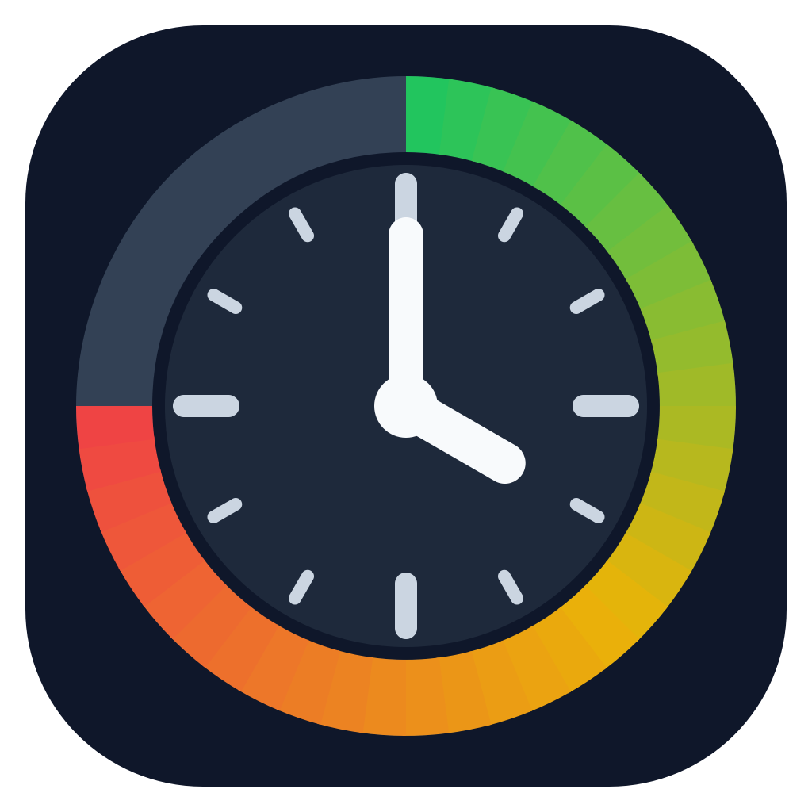
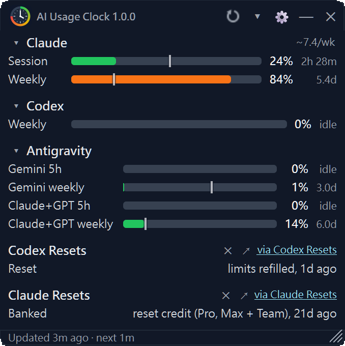
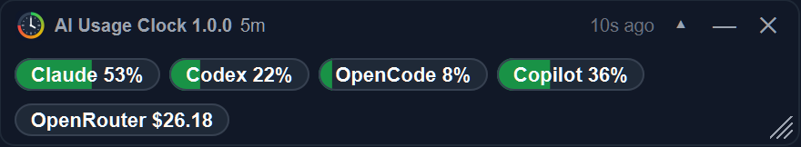

<p align="center">
  
</p>

<h1 align="center">AI Usage Clock</h1>

<p align="center"><strong>Veja cada limite de IA. Fique por dentro de cada redefinição.</strong></p>

<p align="center">
  Um pequeno widget de desktop que reúne os limites de uso dos seus serviços de IA. Ele também acompanha<br />
  os anúncios de redefinição do Codex e do Claude: você é avisado quando uma redefinição é anunciada com antecedência<br />
  e tem onde conferir quando o seu uso zera de repente.
</p>

<p align="center">
  <a href="README.md">English</a> · <a href="README.zh-Hant.md">繁體中文</a> · <a href="README.zh-Hans.md">简体中文</a> · <a href="README.ja.md">日本語</a> · <a href="README.es.md">Español</a> · <a href="README.fr.md">Français</a> · <a href="README.de.md">Deutsch</a> · <strong>Português (Brasil)</strong> · <a href="README.vi.md">Tiếng Việt</a> · <a href="README.eo.md">Esperanto</a>
</p>

<p align="center">
  <a href="https://github.com/AIUsageClock/ai-usage-clock/actions/workflows/test.yml"></a>
  
  
</p>

<p align="center">
  <a href="https://github.com/AIUsageClock/ai-usage-clock/releases/latest"></a>
  <a href="https://aiusageclock.com/pt-br/"></a>
</p>

<p align="center">
  
</p>

<p align="center"><sub>O widget no Windows, capturado de uma versão publicada em execução. Os valores de uso refletem o momento da captura.</sub></p>

<p align="center">
  
</p>

<p align="center"><sub>O modo compacto reduz o widget a uma pílula por serviço (dados de exemplo).</sub></p>

## Por que usar o AI Usage Clock

- **Os limites das suas IAs em um só lugar.** Claude, Codex, Antigravity, OpenCode Go, GitHub Copilot, OpenRouter e Linear, lado a lado, cada um com a sua barra de uso. Nos limites em andamento, o tempo restante também aparece ao lado da barra.
- **Um aviso antes de algumas redefinições, um lugar para conferir as repentinas.** Ative os anúncios de redefinição e o AI Usage Clock passa a acompanhar os anúncios do Codex e do Claude. Alguns são anunciados com antecedência (os anúncios do Codex, mais uma linha **Watch** com uma previsão feita por IA), para você se preparar. Outros surgem do nada: o card mantém o anúncio mais recente à vista, então, quando o seu uso zerar de repente, você pode conferir se acabou de acontecer uma redefinição, com um clique até a publicação original.
- **Receba uma notificação quando surgir um anúncio.** Se quiser, você pode ser notificado quando aparecer um anúncio novo (notificações nativas no Windows), com uma opção independente para cada tipo. Os anúncios vêm de rastreadores independentes de terceiros e podem chegar com atraso ou estar errados, então confira a publicação original. Esse recurso vem desativado por padrão.
- **Roda no seu computador.** Não existe conta do AI Usage Clock, nem servidor, nem telemetria. As chaves de API ficam guardadas no armazenamento seguro do seu sistema operacional. As sessões de login do Claude e do ChatGPT também ficam lá, além da pasta de perfil do navegador do próprio app.

## Comece em 3 passos

1. **Baixe** o arquivo compactado para o seu sistema na [versão mais recente](https://github.com/AIUsageClock/ai-usage-clock/releases/latest): `ai-usage-clock-<version>-windows.zip`, `ai-usage-clock-<version>-macos.tar.gz` ou `ai-usage-clock-<version>-linux.tar.gz`.
2. **Extraia e abra o app.**
   - Windows: execute `ai-usage-clock.exe`
   - macOS: arraste `ai-usage-clock.app` para a pasta Aplicativos e abra-o
   - Linux: execute `./ai-usage-clock/ai-usage-clock`
3. **Conecte os seus serviços.** Entre no Claude e no Codex pelo próprio app, ou cole uma chave de API em **Settings**. Veja o [guia de configuração](docs/setup.md) (em inglês).

As versões publicadas não são assinadas, então o Windows ou o macOS podem exibir um aviso na primeira vez que você abrir o app. [Veja o que fazer](#o-smartscreen-ou-o-gatekeeper-exibe-um-aviso-na-primeira-abertura).

## Serviços compatíveis

| Serviço | O que você vê | Como se conecta |
| --- | --- | --- |
| **Claude** | Limites Session e Weekly (mais o limite semanal do Fable nos planos que têm um) | Entre pelo navegador (login com Google e passkeys funcionam) ou cole um cookie de sessão |
| **Codex** (ChatGPT) | Limites Session e Weekly | Igual ao Claude |
| **Antigravity** | Uso do Gemini e do Claude+GPT, cada um com limites de 5 horas e semanal; o agy informa quais modelos fazem parte de cada grupo | Lê a ferramenta de linha de comando `agy` instalada no seu computador; não precisa de conta nem de chave no app |
| **OpenCode Go** | Uso Rolling, Weekly e Monthly | Chave de API do OpenCode |
| **GitHub Copilot** | Créditos de IA mensais consumidos em relação ao que o seu plano inclui, com redefinição no dia 1º | Fine-grained personal access token do GitHub |
| **OpenRouter** | Gasto de hoje e do mês, com um orçamento diário opcional; saldo e atividade por modelo com uma chave de gerenciamento | Chave de API do OpenRouter |
| **Linear** | Número de issues em relação ao limite de 250 do plano gratuito (os planos pagos mostram "no limit") | Chave de API pessoal do Linear |

Claude, Codex e GitHub Copilot vêm ativados por padrão. Os outros serviços, e os anúncios de redefinição, são ativados em **Settings**. Você pode acompanhar mais de uma conta do Claude, do Codex ou do OpenCode Go.

## Para agentes de IA (MCP)

O AI Usage Clock inclui um servidor MCP local opcional, desativado por padrão. Com ele, agentes de programação podem checar o seu uso antes de começar um trabalho caro e fazer uma pausa quando um limite definido por você for atingido. Ele lê apenas um cache de uso local já higienizado, nunca as suas credenciais. A configuração está em [docs/mcp.md](docs/mcp.md) (em inglês).

## Perguntas frequentes

### Como funcionam os anúncios de redefinição?

Eles vêm desativados. Ative em **Settings → General**, ligando **Codex Resets** ou **Claude Resets**. A partir daí, o AI Usage Clock lê dois rastreadores independentes de terceiros: o codex-resets.com (que usa IA para classificar as publicações de @thsottiaux) e o claude-resets.com (que reúne as publicações de @ClaudeDevs e de membros da equipe do Claude Code). Enquanto o app está em execução, ele consulta cada rastreador no máximo uma vez a cada 15 minutos (ao reiniciar o app, ele consulta de novo).

O card mostra o evento mais recente e há quanto tempo ele aconteceu, com um rótulo conforme o tipo:

- **Announced**: uma redefinição foi anunciada com antecedência. Só o Codex tem este tipo.
- **Reset**: os limites foram recarregados.
- **Banked**: você recebeu um crédito de redefinição que pode resgatar por conta própria.

O card do Codex também tem uma linha **Watch**, uma previsão feita por IA de quão provável é uma redefinição. Ela não é um anúncio oficial e nunca envia notificação. Clique em ↗ para abrir a publicação original, ou em ✕ para ocultar o card até a próxima entrada chegar.

Em **Settings → Reset alerts**, você escolhe de quais tipos quer receber notificação (Codex: Announced, Reset e Banked; Claude: Reset e Banked). O primeiro evento que o app encontra em cada rastreador é apenas registrado, sem notificação. O Windows usa notificações nativas, que abrem a publicação original quando você clica; os outros sistemas usam um balão na bandeja do sistema, quando existe uma bandeja. Não há notificações no modo de barra de menus do macOS nem no Linux sem bandeja, mas os cards continuam sendo atualizados.

Os dados são compilados por terceiros e podem chegar com atraso ou estar errados (entradas novas do Claude podem ficar provisórias por até 24 horas), então trate a publicação original como a fonte da verdade.

### É um app oficial?

Não. O AI Usage Clock é um projeto independente de código aberto e um utilitário de desktop local não oficial, não criado nem endossado por nenhum dos serviços que ele mostra. As páginas e as APIs dos provedores podem mudar sem aviso.

### Para onde vão os meus dados?

Suas configurações, seu histórico de uso e suas sessões de login ficam no seu computador. As sessões e as chaves de API são guardadas nos recursos de credenciais do seu sistema operacional: Gerenciador de Credenciais e DPAPI no Windows, Keychain no macOS e Secret Service no Linux. As sessões do Claude e do ChatGPT também ficam na pasta de perfil do navegador do próprio app. Não há telemetria nem servidor do AI Usage Clock. O app se conecta diretamente aos serviços que você ativar: as páginas de uso do Claude e do ChatGPT (carregadas em um navegador embutido) e as APIs do GitHub, do OpenCode, do OpenRouter e do Linear. O Linear (api.linear.app) recebe apenas a sua chave de API e uma consulta com a contagem de issues. O uso do Antigravity vem da ferramenta `agy` no seu computador, que o app executa para você; o `agy` cuida das próprias conexões. Se você ativar os anúncios de redefinição, o app também acessa o codex-resets.com e o claude-resets.com; esses sites veem o seu endereço IP e o nome e a versão do app. O acompanhamento opcional de custos local lê os logs do Claude Code e do Codex no seu computador e não envia nada. Mais detalhes em [SECURITY.md](SECURITY.md) (em inglês).

### O SmartScreen ou o Gatekeeper exibe um aviso na primeira abertura

As versões publicadas não têm assinatura de código, e os hashes SHA256 são publicados junto de cada arquivo compactado.

- **Windows:** se o SmartScreen avisar, clique em **Mais informações** e depois em **Executar assim mesmo**.
- **macOS:** o Gatekeeper bloqueia o app na primeira vez. Tente abri-lo uma vez e depois vá em **Ajustes do Sistema → Privacidade e Segurança**, encontre o app na seção Segurança, clique em **Abrir** e depois em **Abrir Mesmo Assim**, digite a senha de login e clique em **OK** (o botão **Abrir Mesmo Assim** fica disponível por cerca de uma hora depois da tentativa). Ou execute uma vez `xattr -dr com.apple.quarantine ai-usage-clock.app`.
- **Linux:** não há camada de assinatura. Torne `ai-usage-clock` executável, se ele ainda não for.

Mais detalhes, incluindo o auxiliar do MCP no macOS, estão em [docs/build.md](docs/build.md#first-launch-warnings-on-unsigned-builds) (em inglês).

### Preciso do Python?

Para as versões baixadas, não: o Python e o mecanismo do navegador já vêm incluídos. O Python 3.11 ou mais recente só é necessário para rodar a partir do código-fonte ou para contribuir; veja [docs/build.md](docs/build.md) (em inglês).

### Funciona no macOS e no Linux?

Sim, com uma ressalva. O Windows é a plataforma em que o app é desenvolvido e testado com contas reais. As versões para macOS (um item na barra de menus, em vez de um widget flutuante) e para Linux estão publicadas, e os testes automatizados rodam nos três sistemas, mas a atualização com contas reais só foi verificada no Windows 11, então considere o macOS e o Linux como versões iniciais. As notificações de redefinição variam conforme o sistema; veja a primeira pergunta. Se algo não estiver certo, [abra uma issue](https://github.com/AIUsageClock/ai-usage-clock/issues).

### É grátis?

Sim. É gratuito e de código aberto, sob a licença MIT. Os serviços que ele mostra exigem as suas próprias contas ou assinaturas.

<a id="donate"></a>

## Doar

O AI Usage Clock é grátis, você doando ou não. Se ele economizou o seu tempo e você quiser agradecer, pode enviar criptomoedas para o endereço abaixo. Qualquer token na Ethereum ou na Polygon é bem-vindo: ETH, POL, USDT, USDC ou qualquer outro. O endereço é o mesmo nas duas redes.

```
0x6c60bFCaDfb3AD63eC6D821baB0E6323361BFD4f
```

<p align="center"></p>

- Só são aceitas transferências na Ethereum (ERC20) e na Polygon. Se você puder usar qualquer uma das duas, a Polygon costuma ter taxas menores.
- Este é o único endereço oficial, e o mesmo aparece em [aiusageclock.com](https://aiusageclock.com/pt-br/#donate). Você nunca será solicitado a enviar para outro.
- As transferências na blockchain não podem ser revertidas, então não é possível devolver o valor.

Dar uma estrela ao AI Usage Clock no GitHub ou indicá-lo a um amigo também ajuda.

## Mais

[Guia de configuração](docs/setup.md) (em inglês) · [Uso diário](docs/usage.md) (em inglês) · [Proteção de uso via MCP](docs/mcp.md) (em inglês) · [Compilar a partir do código-fonte](docs/build.md) (em inglês) · [Como contribuir](CONTRIBUTING.md) (em inglês) · [Segurança](SECURITY.md) (em inglês) · [Licença (MIT)](LICENSE) (em inglês)

Versão atual: **1.1.0** · [Changelog](CHANGELOG.md) (em inglês)

O AI Usage Clock não é afiliado à Anthropic, OpenAI, Google, GitHub, Microsoft, OpenCode, OpenRouter, Linear nem a qualquer outro provedor. Os nomes de produtos pertencem aos seus respectivos donos.
