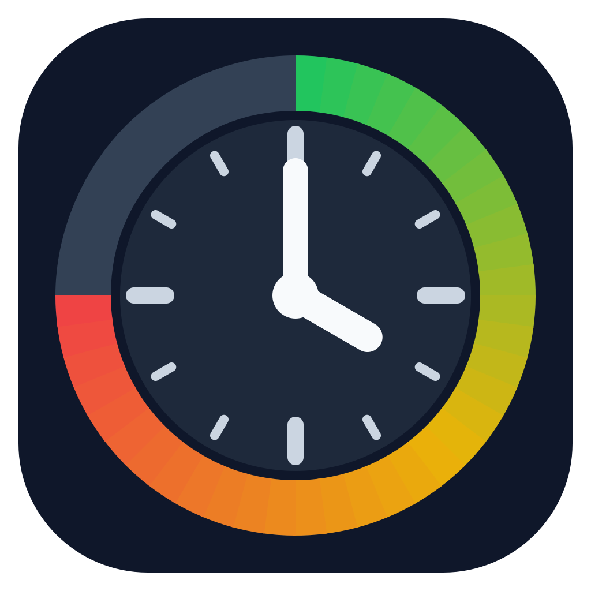
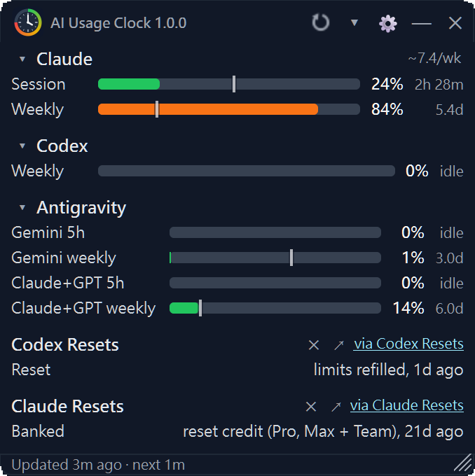
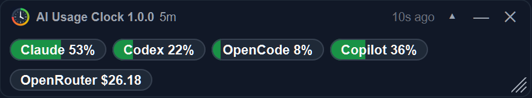

<p align="center">
  
</p>

<h1 align="center">AI Usage Clock</h1>

<p align="center"><strong>Thấy mọi giới hạn AI. Biết mọi lần đặt lại.</strong></p>

<p align="center">
  Một widget nhỏ trên màn hình nền, gom giới hạn sử dụng của các dịch vụ AI bạn dùng. Nó cũng nhận<br />
  các thông báo đặt lại của Codex và Claude: bạn được báo trước khi có lần đặt lại được công bố sớm,<br />
  và có chỗ để xem lại khi mức sử dụng của bạn bỗng về 0.
</p>

<p align="center">
  <a href="README.md">English</a> · <a href="README.zh-Hant.md">繁體中文</a> · <a href="README.zh-Hans.md">简体中文</a> · <a href="README.ja.md">日本語</a> · <a href="README.es.md">Español</a> · <a href="README.fr.md">Français</a> · <a href="README.de.md">Deutsch</a> · <a href="README.pt-BR.md">Português (Brasil)</a> · <strong>Tiếng Việt</strong> · <a href="README.eo.md">Esperanto</a>
</p>

<p align="center">
  <a href="https://github.com/AIUsageClock/ai-usage-clock/actions/workflows/test.yml"></a>
  
  
</p>

<p align="center">
  <a href="https://github.com/AIUsageClock/ai-usage-clock/releases/latest"></a>
  <a href="https://aiusageclock.com/vi/"></a>
</p>

<p align="center">
  
</p>

<p align="center"><sub>Widget trên Windows, chụp từ một bản phát hành đang chạy. Các giá trị sử dụng là của thời điểm chụp.</sub></p>

<p align="center">
  
</p>

<p align="center"><sub>Chế độ thu gọn co widget lại thành một thanh gọn hình viên thuốc cho mỗi dịch vụ (dữ liệu mẫu).</sub></p>

## Vì sao nên dùng AI Usage Clock

- **Mọi giới hạn AI của bạn, ở một nơi.** Claude, Codex, Antigravity, OpenCode Go, GitHub Copilot, OpenRouter và Linear nằm cạnh nhau, mỗi dịch vụ có thanh mức sử dụng riêng. Với những giới hạn đang hoạt động, bên cạnh thanh còn hiện thời gian còn lại.
- **Được báo trước một số lần đặt lại, và có chỗ kiểm tra những lần đặt lại bất ngờ.** Bật thông báo đặt lại và AI Usage Clock sẽ nhận các thông báo đặt lại của Codex và Claude. Một số lần đặt lại được công bố trước (các thông báo của Codex, cùng một hàng Watch do AI dự báo), nên bạn kịp chuẩn bị. Số khác đến bất ngờ: ô hiển thị luôn giữ thông báo mới nhất trong tầm mắt, nên khi mức sử dụng của bạn bỗng về 0, bạn có thể kiểm tra xem có phải vừa có lần đặt lại không, và chỉ một cú nhấp là mở được bài đăng gốc.
- **Được nhắc khi có thông báo mới.** Nếu muốn, bạn có thể nhận thông báo mỗi khi có một thông báo đặt lại mới (trên Windows dùng thông báo gốc của hệ thống), với công tắc riêng cho từng loại. Các thông báo này đến từ những trang theo dõi độc lập của bên thứ ba và có thể chậm hoặc sai, vì vậy hãy kiểm tra bài đăng gốc. Tính năng này tắt theo mặc định.
- **Chạy ngay trên máy tính của bạn.** Không có tài khoản AI Usage Clock, không có máy chủ, không có thu thập dữ liệu từ xa (telemetry). Khóa API được lưu trong kho lưu trữ bảo mật của hệ điều hành. Các phiên đăng nhập Claude và ChatGPT cũng được lưu ở đó, cùng với thư mục hồ sơ trình duyệt riêng của ứng dụng.

## Bắt đầu trong 3 bước

1. **Tải xuống** tệp nén dành cho hệ điều hành của bạn từ [bản phát hành mới nhất](https://github.com/AIUsageClock/ai-usage-clock/releases/latest): `ai-usage-clock-<version>-windows.zip`, `ai-usage-clock-<version>-macos.tar.gz` hoặc `ai-usage-clock-<version>-linux.tar.gz`.
2. **Giải nén và chạy.**
   - Windows: chạy `ai-usage-clock.exe`
   - macOS: kéo `ai-usage-clock.app` vào thư mục Applications rồi mở nó
   - Linux: chạy `./ai-usage-clock/ai-usage-clock`
3. **Kết nối các dịch vụ của bạn.** Đăng nhập Claude và Codex ngay trong ứng dụng, hoặc dán khóa API vào **Settings**. Xem [hướng dẫn cài đặt](docs/setup.md) (tiếng Anh).

Các bản phát hành chưa được ký mã, nên Windows hoặc macOS có thể cảnh báo ở lần mở ứng dụng đầu tiên. [Đây là cách xử lý](#windows-smartscreen-hoặc-macos-gatekeeper-cảnh-báo-khi-mở-ứng-dụng-lần-đầu).

## Các dịch vụ được hỗ trợ

| Dịch vụ | Bạn thấy gì | Cách kết nối |
| --- | --- | --- |
| **Claude** | Giới hạn Session và Weekly (kèm giới hạn Fable theo tuần ở những gói có giới hạn này) | Đăng nhập qua trình duyệt (dùng Google hoặc passkey đều được), hoặc dán cookie phiên |
| **Codex** (ChatGPT) | Giới hạn Session và Weekly | Giống Claude |
| **Antigravity** | Mức sử dụng Gemini và Claude+GPT, mỗi loại có giới hạn 5 giờ và giới hạn theo tuần; agy cho biết những mô hình nào thuộc mỗi nhóm | Đọc công cụ dòng lệnh `agy` có sẵn trên máy của bạn; không cần tài khoản hay khóa trong ứng dụng |
| **OpenCode Go** | Mức sử dụng Rolling, Weekly và Monthly | Khóa API của OpenCode |
| **GitHub Copilot** | Tín dụng AI hằng tháng đã dùng so với mức gói của bạn cho phép, đặt lại vào ngày 1 | Personal access token dạng fine-grained của GitHub |
| **OpenRouter** | Chi tiêu hôm nay và tháng này, kèm ngân sách theo ngày tùy chọn; số dư và hoạt động theo từng mô hình với khóa quản lý | Khóa API của OpenRouter |
| **Linear** | Số issue so với giới hạn 250 issue của gói Free (các gói trả phí hiển thị "no limit") | Khóa API cá nhân của Linear |

Claude, Codex và GitHub Copilot được bật theo mặc định. Các dịch vụ còn lại, cùng thông báo đặt lại, được bật trong **Settings**. Bạn có thể theo dõi nhiều hơn một tài khoản Claude, Codex hoặc OpenCode Go.

## Dành cho tác tử AI (MCP)

AI Usage Clock có kèm một máy chủ MCP cục bộ tùy chọn, tắt theo mặc định. Nó cho phép các tác tử lập trình kiểm tra mức sử dụng của bạn trước khi bắt đầu công việc tốn kém và tạm dừng khi chạm một giới hạn do bạn đặt. Nó chỉ đọc một bộ nhớ đệm sử dụng cục bộ đã được loại bỏ dữ liệu nhạy cảm, không bao giờ đọc thông tin xác thực của bạn. Cách thiết lập nằm trong [docs/mcp.md](docs/mcp.md) (tiếng Anh).

## Câu hỏi thường gặp

### Thông báo đặt lại hoạt động thế nào?

Chúng tắt theo mặc định. Hãy bật trong **Settings → General** với **Codex Resets** hoặc **Claude Resets**. Khi đó AI Usage Clock sẽ đọc hai trang theo dõi độc lập của bên thứ ba: codex-resets.com (dùng AI để phân loại các bài đăng của @thsottiaux) và claude-resets.com (tổng hợp các bài đăng của @ClaudeDevs và các thành viên nhóm Claude Code). Khi ứng dụng đang chạy, nó hỏi mỗi trang tối đa 15 phút một lần (khởi động lại ứng dụng thì hỏi lại).

Ô hiển thị sự kiện mới nhất và nó xảy ra cách đây bao lâu, kèm nhãn theo loại:

- **Announced**: một lần đặt lại được công bố trước. Chỉ Codex có loại này.
- **Reset**: giới hạn đã được nạp lại.
- **Banked**: bạn được cấp một phiếu đặt lại mà bạn có thể tự dùng.

Ô Codex còn có một hàng **Watch**, một dự báo do AI đưa ra về khả năng có lần đặt lại. Đó không phải là thông báo chính thức và nó không bao giờ gửi nhắc nhở. Nhấp ↗ để mở bài đăng gốc, hoặc ✕ để ẩn ô này cho đến khi có mục mới.

Trong **Settings → Reset alerts**, bạn chọn loại nào sẽ nhắc bạn (Codex: announced, reset, banked; Claude: reset, banked). Sự kiện đầu tiên mà ứng dụng tìm thấy ở mỗi trang theo dõi chỉ được ghi lại, không gửi nhắc nhở. Windows dùng thông báo gốc của hệ thống, nhấp vào sẽ mở bài đăng gốc; các hệ thống khác dùng thông báo dạng bong bóng ở khay hệ thống khi có khay. Ở chế độ thanh menu của macOS hoặc trên Linux không có khay thì không có thông báo, nhưng các ô vẫn được cập nhật.

Dữ liệu do bên thứ ba tổng hợp nên có thể chậm hoặc sai (các mục Claude mới có thể ở trạng thái tạm thời tới 24 giờ), vì vậy hãy xem bài đăng gốc là nguồn đáng tin cậy.

### Đây có phải ứng dụng chính thức không?

Không. AI Usage Clock là một dự án mã nguồn mở độc lập và là một tiện ích máy tính cục bộ không chính thức, không do dịch vụ nào trong số mà nó hiển thị tạo ra hay bảo trợ. Trang và API của các nhà cung cấp có thể thay đổi mà không báo trước.

### Dữ liệu của bạn đi đâu?

Cài đặt, lịch sử sử dụng và các phiên đăng nhập của bạn nằm lại trên máy tính của bạn. Phiên đăng nhập và khóa API được lưu bằng cơ chế quản lý thông tin xác thực của hệ điều hành: Credential Manager và DPAPI trên Windows, Keychain trên macOS, Secret Service trên Linux. Các phiên Claude và ChatGPT cũng được lưu trong thư mục hồ sơ trình duyệt riêng của ứng dụng. Không có thu thập dữ liệu từ xa (telemetry) và không có máy chủ của AI Usage Clock. Ứng dụng kết nối trực tiếp tới các dịch vụ bạn bật: các trang mức sử dụng của Claude và ChatGPT (được tải trong một trình duyệt tích hợp sẵn), cùng các API của GitHub, OpenCode, OpenRouter và Linear. Linear (api.linear.app) chỉ nhận khóa API của bạn và một truy vấn đếm số issue. Mức sử dụng Antigravity lấy từ công cụ `agy` trên máy tính của bạn, do ứng dụng chạy giúp bạn; `agy` tự xử lý các kết nối của nó. Nếu bạn bật thông báo đặt lại, ứng dụng cũng liên hệ với codex-resets.com và claude-resets.com; các trang đó thấy địa chỉ IP của bạn cùng tên và phiên bản của ứng dụng. Tính năng theo dõi chi phí cục bộ (tùy chọn) đọc nhật ký Claude Code và Codex trên máy tính của bạn và không tải gì lên. Xem thêm trong [SECURITY.md](SECURITY.md) (tiếng Anh).

### Windows SmartScreen hoặc macOS Gatekeeper cảnh báo khi mở ứng dụng lần đầu

Các bản phát hành chưa được ký mã, và mã SHA256 được công bố cạnh từng tệp nén.

- **Windows:** nếu SmartScreen cảnh báo, nhấp **Thông tin khác**, rồi nhấp **Vẫn chạy**.
- **macOS:** Gatekeeper chặn ứng dụng ở lần đầu. Hãy thử mở ứng dụng một lần, rồi vào **Cài đặt hệ thống → Quyền riêng tư & bảo mật**, tìm ứng dụng trong mục bảo mật, nhấp **Mở**, rồi nhấp **Vẫn mở**, nhập mật khẩu đăng nhập của bạn và nhấp **OK** (nút **Vẫn mở** khả dụng trong khoảng một giờ sau lần thử mở). Hoặc chạy một lần lệnh `xattr -dr com.apple.quarantine ai-usage-clock.app`.
- **Linux:** không có bước ký mã. Hãy cấp quyền thực thi cho `ai-usage-clock` nếu tệp chưa có quyền này.

Chi tiết hơn, gồm cả công cụ hỗ trợ MCP trên macOS, nằm trong [docs/build.md](docs/build.md#first-launch-warnings-on-unsigned-builds) (tiếng Anh).

### Tôi có cần Python không?

Không cần với các bản tải xuống: Python và công cụ trình duyệt đã được đóng gói sẵn. Chỉ cần Python 3.11 trở lên khi chạy từ mã nguồn hoặc khi đóng góp; xem [docs/build.md](docs/build.md) (tiếng Anh).

### Nó có chạy trên macOS và Linux không?

Có, nhưng cần lưu ý. Windows là nền tảng mà nó được phát triển và thử nghiệm với tài khoản thật. Bản macOS (một mục trên thanh menu thay vì widget nổi) và bản Linux đã được phát hành, và các bài kiểm thử tự động chạy trên cả ba hệ điều hành, nhưng việc làm mới dữ liệu tài khoản thật mới chỉ được kiểm chứng trên Windows 11, nên hãy xem macOS và Linux là bản thử nghiệm ban đầu. Thông báo đặt lại khác nhau tùy hệ thống; xem câu hỏi đầu tiên. Nếu có gì không ổn, bạn vui lòng [mở một issue](https://github.com/AIUsageClock/ai-usage-clock/issues).

### Nó có miễn phí không?

Có. Nó miễn phí và là mã nguồn mở theo giấy phép MIT. Các dịch vụ mà nó hiển thị cần có tài khoản hoặc gói đăng ký riêng.

<a id="donate"></a>

## Ủng hộ AI Usage Clock

AI Usage Clock được dùng miễn phí, dù bạn có ủng hộ hay không. Nếu nó đã giúp bạn tiết kiệm chút thời gian và bạn muốn nói lời cảm ơn, bạn có thể gửi tiền mã hóa tới địa chỉ bên dưới. Mọi token trên Ethereum hoặc Polygon đều được chào đón: ETH, POL, USDT, USDC hay bất kỳ token nào khác. Cả hai mạng dùng chung một địa chỉ.

```
0x6c60bFCaDfb3AD63eC6D821baB0E6323361BFD4f
```

<p align="center"></p>

- Chỉ nhận chuyển khoản trên Ethereum (ERC20) và Polygon. Nếu bạn dùng được cả hai, Polygon thường có phí thấp hơn.
- Đây là địa chỉ chính thức duy nhất, và cùng địa chỉ này cũng hiện trên [aiusageclock.com](https://aiusageclock.com/vi/#donate). Bạn sẽ không bao giờ bị nhờ gửi tới một địa chỉ khác.
- Giao dịch trên chuỗi khối không thể hoàn tác nên không thể hoàn tiền.

Gắn sao cho AI Usage Clock trên GitHub hoặc giới thiệu cho một người bạn cũng là một cách giúp đỡ.

## Xem thêm

[Hướng dẫn cài đặt](docs/setup.md) (tiếng Anh) · [Dùng hằng ngày](docs/usage.md) (tiếng Anh) · [Bảo vệ mức sử dụng MCP](docs/mcp.md) (tiếng Anh) · [Biên dịch từ mã nguồn](docs/build.md) (tiếng Anh) · [Đóng góp](CONTRIBUTING.md) (tiếng Anh) · [Bảo mật](SECURITY.md) (tiếng Anh) · [Giấy phép (MIT)](LICENSE) (tiếng Anh)

Phiên bản hiện tại: **1.1.0** · [Nhật ký thay đổi](CHANGELOG.md) (tiếng Anh)

AI Usage Clock không liên kết với Anthropic, OpenAI, Google, GitHub, Microsoft, OpenCode, OpenRouter, Linear hay bất kỳ nhà cung cấp nào khác. Tên sản phẩm thuộc về chủ sở hữu của chúng.
